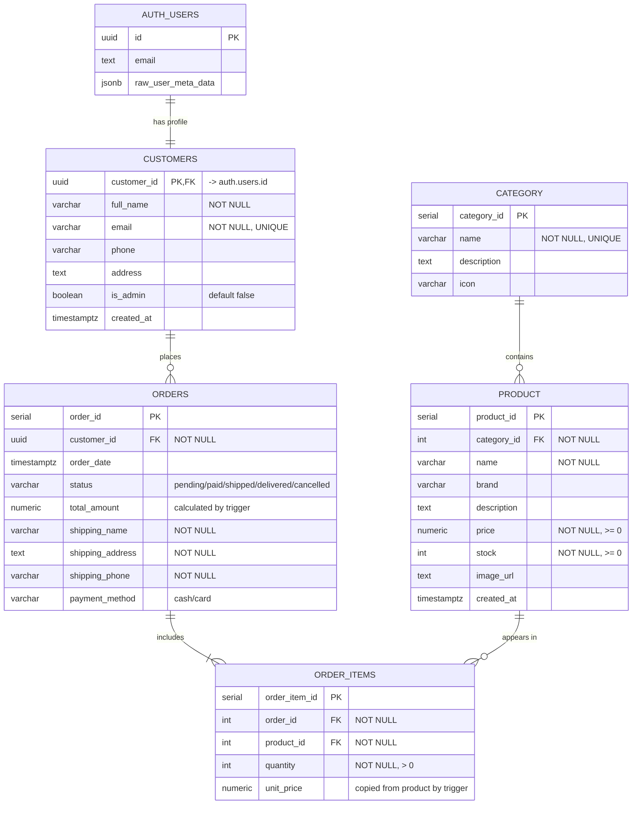

# Entity Relationship Diagram

GitHub renders the diagram below automatically. To get an image for the report,
paste the code into https://mermaid.live and export it as PNG.

## Relationships

| Relationship | Type | Foreign key | On delete |
|---|---|---|---|
| category → product | one-to-many | `product.category_id` | restrict (can't delete a category that still has products) |
| auth.users → customers | one-to-one | `customers.customer_id` | cascade |
| customers → orders | one-to-many | `orders.customer_id` | cascade |
| orders → order_items | one-to-many | `order_items.order_id` | cascade |
| product → order_items | one-to-many | `order_items.product_id` | restrict (keeps order history correct) |

`order_items` is the junction table that resolves the many-to-many relationship
between `orders` and `product`. The pair `(order_id, product_id)` is unique.
